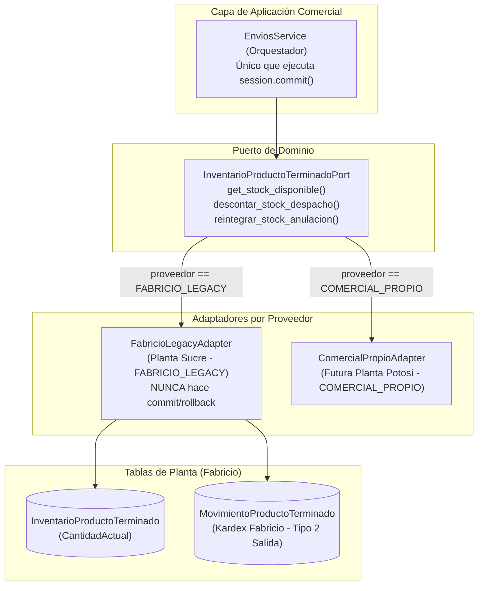

# ARCHITECTURE.md - ARQUITECTURA TÉCNICA DEL SISTEMA BLANQUITA
*Fuente de la Verdad Técnica para el Agente Principal y Subagentes*

---

## 1. STACK TECNOLÓGICO EXACTO DETECTADO

| Capa / Área | Tecnología / Librería | Versión / Detalle |
| :--- | :--- | :--- |
| **Frontend Framework** | Astro + React 19 Islands (`client:load`, `client:idle`) | Astro `^7.0.3`, React `^19.2.8`, Tailwind CSS `^4.3.3` |
| **Frontend Router / Pages** | Astro Pages File-Based Routing | `src/pages/**` (SSR híbrido con adaptadores Vercel/Node) |
| **Frontend UI Components** | Tailwind CSS v4, Lucide React, Sonner (Toasts) | `@tailwindcss/vite`, `lucide-react`, `sonner`, `date-fns` |
| **Frontend Auth / Proxy** | Cookies seguras + Astro API Endpoints proxy | `src/pages/api/[...path].js`, `src/lib/auth-server.js` |
| **Backend Framework** | FastAPI (Python 3.13) | `fastapi`, `uvicorn`, `pydantic` v2, `slowapi` (rate limit) |
| **Base de Datos** | PostgreSQL 15+ alojado en Supabase | Connection Pooling `QueuePool` persistente (SSL activado) |
| **Acceso a Datos / ORM** | SQLAlchemy Core + Psycopg2 + Stored Procedures | `DbCaller.py` parametrizado + funciones PL/pgSQL |
| **Autenticación Backend** | JWT Tokens (Supabase Auth / PyJWT) | Verificación JWKS asimétrica con caché RAM local |
| **Librerías de Exportación** | Generador CSV/Excel nativo + Impresión formal | `exportarCsv.js`, CSS `@media print` apaisado |
| **Entorno de Pruebas** | Pytest (Backend) | `pytest` 9.1.1 con fixtures unitarios y pruebas p2p |
| **Despliegue / Hosting** | Frontend en Vercel, Backend en Render / VM Linux | Supabase DB como nodo centralizado de datos |

---

## 2. MATRIZ DE ZONAS DE TABLAS Y MÓDULOS

Todo agente debe clasificar cada archivo y tabla en una de estas tres categorías:

### 2.1 Zona PROTEGIDA (Planta de Fabricio) - DDL Blindado y DML Restringido
*Prohibido alterar esquemas (DDL). Escritura DML estrictamente controlada por adaptador oficial.*

| Módulo | Tablas en Base de Datos | Política de Acceso / Restricción |
| :--- | :--- | :--- |
| **Bobina Papel** | `TipoBobina`, `EstadoMateriaPrima`, `LoteBobina`, `BobinaPapel`, `MovimientoBobina` | **SOLO LECTURA**. Prohibido escribir o modificar tablas. Backend: `app/**/BobinaPapel/**`, Frontend: `src/components/PapelBobina/**`. |
| **Bobina Servilleta** | `TipoBobinaServilleta`, `FormatoSubBobina`, `TipoMedidaSubBobina`, `LoteBobinaServilleta`, `BobinaServilleta`, `UnidadBobinaServilleta`, `SubBobinaServilleta`, `MovimientoSubBobina` | **SOLO LECTURA**. Backend: `app/**/BobinaServilleta/**`, Frontend: `src/components/ServilletaBobina/**`, SQL: `functionsServilleta.sql`. |
| **Rodelas** | `LoteRodela`, `TipoRodela`, `Rodela`, `MovimientoRodela` | **SOLO LECTURA**. Backend: `app/**/Rodela/**`, Frontend: `src/components/Rodela/**`. |
| **Empaques** | `LoteEmpaque`, `TipoEmpaque`, `Empaque`, `MovimientoEmpaque`, `TipoEmpaqueBolsa`, `MovimientoEmpaqueBolsa`, `InventarioEmpaqueBolsa`, `TipoBolsaJava`, `MovimientoBolsaJava`, `InventarioBolsaJava` | **SOLO LECTURA**. Backend: `app/**/Empaque/**`, Frontend: `src/components/Empaque/**`. |
| **Producción de Planta** | `EstadoProduccion`, `ProduccionBobinaTubo`, `ProduccionServilleta`, `PausaProduccionBobinaTubo`, `PausaProduccionServilleta`, `CancelacionProduccionBobinaTubo`, `CancelacionProduccionServilleta` | **SOLO LECTURA**. Backend: `app/**/Produccion*`, Frontend: `src/pages/encargado/**`, `src/pages/operador/**`. |
| **Inventario Fábrica / Planta** | `TipoMovimientoInventario`, `MovimientoProductoTerminado`, `InventarioProductoTerminado`, `TipoInsumo`, `MovimientoInsumo`, `InventarioInsumo`, `TipoMovimientoOperadorLogs`, `MovimientoOperadorLogs` | **DDL BLINDADO**. En `InventarioProductoTerminado` y `MovimientoProductoTerminado`: DML (`UPDATE` de saldo / `INSERT` de egreso tipo 2 'Salida') **autorizado EXCLUSIVAMENTE a través de `FabricioLegacyAdapter`**. Queda prohibido escribir desde cualquier otro servicio. Insumos y logs de planta son SOLO LECTURA. |

### 2.2 Zona EXTENSIBLE (Comercial, Tesorería, RRHH y Seguridad) - ADAPTACIÓN ADITIVA
*Tablas y módulos existentes que se extienden con columnas nuevas nullable/default.*

| Módulo | Tablas Reales Existentes | Estrategia de Extensión |
| :--- | :--- | :--- |
| **Seguridad y Usuarios** | `Usuario`, `Rol`, `EstadoUsuario`, `AuditLog` | Añadir FK `IdSucursal`, soporte de roles nuevos (`ContadorSucursal`, `Distribuidor`). |
| **Catálogo Productos** | `Producto`, `PresentacionProducto` | **No alterar tabla base**: crear tabla satélite `ProductoConfigComercial`. |
| **Clientes y Distribución** | `Cliente`, `PuntoVenta`, `ZonaDistribucion`, `RutaDistribucion`, `RutaPuntoVenta`, `AsignacionRuta`, `CargaInventarioRuta`, `RendicionRuta` | Añadir `IdSucursal`, campos de cierre con merma/faltante diario. |
| **Precios y Tarifas** | `PrecioProducto` | Añadir `IdSucursal`, `FechaVigenciaDesde`, histórico de precios y auditoría. |
| **Ventas y Despachos** | `NotaVenta`, `DetalleNotaVenta`, `Pedido`, `DetallePedido`, `PagoPedido` | Añadir `IdSucursal`, número NV formal (ej. NV-501), firma digital, control de bandeo. |
| **Cuentas por Cobrar** | `CuentaCobrar`, `PlanPago`, `AbonoCuentaCobrar`, `EstadoCuentaCobrar` | Añadir estado `PENDIENTE_APROBACION`, comprobante QR con foto obligatoria. |
| **Tesorería y Caja** | `Caja`, `AperturaCierreCaja`, `MovimientoCaja`, `CategoriaMovimientoCaja`, `CuentaBancariaEmpresa`, `ArqueoCajaDetalle` | Añadir `IdSucursal`, desglose en 3 bancos referenciales (MSC, Unión, BNB). |
| **Caja Chica** | `SolicitudCajaChica` | Añadir ciclo de vida (`PENDIENTE` -> `ENTREGADO` -> `RENDIDO`), `aprobacion_gerencia`. |
| **Cuentas por Pagar** | `CuentaPagarProveedor`, `PagoCuentaPagar`, `Proveedor` | Añadir `IdSucursal` para gastos locales y de proveedores. |
| **Personal y Nómina** | `DatosLaboralesEmpleado`, `PeriodoNomina`, `Planilla`, `DetallePlanilla`, `AsistenciaDiaria`, `ConfiguracionLaboral` | Pestañas Asegurado/Externo, importador Excel (col AJ), descuento "No venta", finiquito exacto. |

### 2.3 Zona NUEVA (Fase 1 en adelante)
*Tablas y componentes nuevos creados mediante migraciones formales de Alembic (`alembic/versions/`).*
- `sucursales`: Registro de sedes comerciales (Sucre, Potosí, N futuras).
- `plantas`: Catálogo multi-planta con proveedor de inventario (`FABRICIO_LEGACY` para Sucre, `COMERCIAL_PROPIO` para futura planta en Potosí).
- `envios_inventario` y `detalles_envio_inventario`: Traslados polimórficos de inventario (Planta $\rightarrow$ Sucursal, Sucursal $\rightarrow$ Sucursal, Planta $\rightarrow$ Planta), con columna `descuento_planta_aplicado (bool)`.
- `mermas_envio`: Registro de faltantes y mermas en tránsito cuando `cantidad_recibida < cantidad_enviada`.
- `inventario_sucursal`: Stock comercial físico por sucursal, unificado e indexado por `presentacion_id` (`IdPresentacion`).
- `inventario_chofer`: Stock cargado al camión indexado por `presentacion_id` para venta móvil.
- `revalorizacion_inventario_chofer`: Bitácora de revalorización al cambiar precios vigentes.
- `notificaciones_internas`: Alertas gerenciales por cambios de precio, notas o caja.
- `comprobante_archivo`: Metadatos de comprobantes con cron job de limpieza (60 días).
- `producto_config_comercial`: Satélite con datos de bandeo (servilleta de regalo).
- `pedidos_distribuidor` / `detalles_pedido_distribuidor`: Solicitudes de pedidos de distribuidores basadas en stock real y aprobadas por Kevin.

---

## 3. RESUMEN DEL DISEÑO DE BASE DE DATOS Y MAPEO DE NOMBRES

El diseño pormenorizado campo por campo se encuentra en [`docs/context/DB_ESQUEMA.md`](docs/context/DB_ESQUEMA.md).

### Tabla de Mapeo "Nombre Sugerido en Requerimientos → Nombre Real en BD"

| Concepto de Negocio | Nombre Sugerido | Nombre Real Detectado / Implementado | Estado |
| :--- | :--- | :--- | :--- |
| Sucursal | `sucursal` | `public.sucursales` | **NUEVA TABLA** (Alembic) |
| Catálogo de Plantas | `planta` | `public.plantas` | **NUEVA TABLA** (Alembic) |
| Envíos y Traslados | `envio_fabrica` | `public.envios_inventario` + `detalles_envio_inventario` | **NUEVA TABLA** (Alembic) |
| Mermas en Tránsito | `merma_envio` | `public.mermas_envio` | **NUEVA TABLA** (Alembic) |
| Inventario Comercial | `inventario_sucursal` | `public.inventario_sucursal` (por `IdPresentacion`) | **NUEVA TABLA** (Alembic) |
| Inventario Móvil | `inventario_chofer` | `public.inventario_chofer` (por `IdPresentacion`) | **NUEVA TABLA** (Alembic) |
| Empleado / Personal | `personal`, `empleado` | `public.DatosLaboralesEmpleado` + `public.Usuario` | Existente (Extensible) |
| Chofer / Repartidor | `chofer`, `repartidor` | `public.Usuario` (`IdRol = 6` o asignación en `AsignacionRuta`) | Existente (Extensible) |
| Notas de Venta | `nota_venta` | `public.NotaVenta` | Existente (Extensible) |
| Detalle de Venta | `detalle_venta` | `public.DetalleNotaVenta` (por `IdPresentacion`) | Existente (Extensible) |
| Precios Oficiales | `lista_precios` | `public.PrecioProducto` | Existente (Extensible) |
| Cuentas por Cobrar | `cuentas_cobrar` | `public.CuentaCobrar` | Existente (Extensible) |
| Abonos de Cobranza | `abono` | `public.AbonoCuentaCobrar` | Existente (Extensible) |
| Solicitud Caja Chica | `caja_chica` | `public.SolicitudCajaChica` | Existente (Extensible) |
| Movimiento de Caja | `movimiento_caja` | `public.MovimientoCaja` | Existente (Extensible) |
| Cuentas por Pagar | `cuentas_pagar` | `public.CuentaPagarProveedor` | Existente (Extensible) |
| Planilla Salarial | `planilla` | `public.Planilla` | Existente (Extensible) |
| Detalle de Planilla | `boleta_pago` | `public.DetallePlanilla` | Existente (Extensible) |
| Asistencia Biometría | `asistencia` | `public.AsistenciaDiaria` | Existente (Extensible) |
| Auditoría | `auditoria` | `public.AuditLog` | Existente (Extensible) |

---

## 4. ARQUITECTURA MULTI-SUCURSAL (Sucre, Potosí, N Sucursales)

### 4.1 Principio de Aislamiento
- Ningún usuario de sucursal (ej. Potosí) puede consultar, modificar o visibilizar datos de otra sucursal (ej. Sucre).
- Las tablas protegidas de planta **no llevan `IdSucursal`** porque residen en la planta matriz Sucre.
- Las tablas comerciales y financieras incorporan `IdSucursal INT REFERENCES public.Sucursal(IdSucursal) ON DELETE RESTRICT`.

### 4.2 Mecanismo de Filtrado Backend
1. **JWT y Metadata:** Al iniciar sesión, el token de usuario contiene su `IdSucursal` asociado.
2. **Dependencia de Inyección (`get_current_user`):**
   ```python
   # Extrae contexto de sucursal
   id_sucursal_usuario = usuario_actual.get("IdSucursal")
   es_gerencia = usuario_actual.get("IsAdmin") or usuario_actual.get("IdRol") in [3]
   ```
3. **Repositorios y Consultas:** Si el usuario no es Gerencia General, toda consulta SQL/ORM inyecta obligatoriamente `WHERE IdSucursal = :id_sucursal`. Si es Gerencia, puede enviar un query param `?sucursal_id=X` opcional o consultar el consolidado global.

### 4.3 Mecanismo de Filtrado Frontend
- Para roles de sucursal, la UI oculta el selector y fija la sucursal activa.
- Para Don Osvaldo / Administrador, la barra de navegación o cabecera despliega un selector global de sucursal (`Todas`, `Sucre`, `Potosí`, etc.), transmitido a las llamadas del API.

---

## 5. MATRIZ DE ROLES Y PERMISOS DEL NEGOCIO

| Rol | Ver | Crear | Editar | Eliminar | Aprobar / Cerrar | Ámbito / Módulos |
| :--- | :---: | :---: | :---: | :---: | :---: | :--- |
| **Administrador General** | Sí | Sí | Sí | Sí | Sí | Todos los módulos, auditoría y seguridad completa. |
| **Don Osvaldo (Gerencia General)** | Sí | No | No | No | Sí | Panel ejecutivo, buscador por código numérico, firma/sello de cheques y caja chica, reportes consolidados. |
| **Kevin (Encargado Contabilidad)** | Sí | Sí | Sí | No | Sí | Tesorería, cuentas por cobrar/pagar, revisión de rendiciones de choferes, edición de pedidos de distribuidores, planillas. |
| **Contador de Sucursal** | Sí | Sí | Sí | No | Sí | Restringido exclusivamente a su `IdSucursal`. Arqueos, caja local y cuentas locales. |
| **Chofer / Repartidor** | Sí | Sí | No | No | No | Hoja de ruta diaria, registro de cobros parciales/QR, entrega de pedidos y firma en móvil. Todo nace `PENDIENTE`. |
| **Encargado de Despacho** | Sí | Sí | No | No | Sí | Generación de notas de entrega y carga física de camiones. |
| **Distribuidor Externo** | Sí | Sí | No | No | No | Catálogo con stock real disponible, creación de pedidos para Oruro/Tarija/La Paz/Tupiza y subida de comprobante. |

---

## 6. SERVICIOS TRANSVERSALES DE LA FASE 1 (Contratos Públicos)

Todos los subagentes deben consumir estos contratos reutilizables sin duplicar lógica:

### a) Servicio de Subida y Depuración de Comprobantes (`FileStorageService`)
- **Ubicación:** `Blanquita-Backend/app/Services/Common/FileStorageService.py`
- **Contrato:**
  ```python
  def guardar_comprobante(archivo: UploadFile, categoria: str, id_referencia: int) -> dict:
      """Valida extensión (.jpg, .png, .pdf), tamaño máximo (5MB), comprime y guarda localmente o en bucket.
      Retorna: {'url': str, 'nombre_archivo': str, 'tamano_bytes': int, 'sha256': str}"""
  ```
- **Cron Job de Limpieza (Depuración automática a los 60 días):**
  Un script programado inspecciona comprobantes de más de 60 días (configurable en `ConfiguracionGeneral`), elimina el archivo físico para ahorrar almacenamiento y actualiza la fila en BD con `archivo_eliminado = TRUE` conservando todos los metadatos de auditoría y fechas.

### b) Motor Generador de Reportes (`ReportEngineService`)
- **Ubicación Backend:** `Blanquita-Backend/app/Services/Reportes/`
- **Ubicación Frontend:** `Blanquita-Frontend/src/components/common/Reportes/`
- **Contrato:**
  - Exportación CSV/Excel estructurado con cabeceras formales mediante `exportarAExcelCSV(nombre, columnas, datos)`.
  - Impresión formal en hoja apaisada (*landscape*) a través de utilidades CSS `@media print` en tablas compactas de alta densidad tipográfica (8pt) con pie de firmas de respaldo.

### c) Sistema de Notificaciones Internas y Buscador Numérico (`NotificationService`)
- **Ubicación:** `Blanquita-Backend/app/Services/Common/NotificationService.py`
- **Contrato:**
  ```python
  def crear_notificacion(id_usuario_destinatario: int, titulo: str, mensaje: str, tipo: str, codigo_referencia: int | None = None) -> None:
      """Genera alerta para campana de notificaciones (cambios de precio, notas editadas, vales de caja)."""
  ```
- **Buscador Gerencial:** Endpoint `/api/gerencia/buscar-reporte?codigo=2208` que localiza de inmediato el documento o comprobante por su ID numérico único.

### d) Componente de Firma Digital Táctil (`FirmaDigital`)
- **Ubicación Frontend:** `Blanquita-Frontend/src/components/common/FirmaDigital.jsx`
- **Contrato Props:**
  ```javascript
  <FirmaDigital 
    onGuardar={(firmaBase64, metadata) => {}} 
    bloqueado={false} 
    etiqueta="Firma del Cliente Receptor" 
  />
  ```
  Captura el trazo en canvas táctil para teléfonos móviles, añade timestamp, usuario e IP, y exporta en PNG transparente optimizado.

### e) Arquitectura Hexagonal de Inventario Multi-Planta (`InventarioProductoTerminadoPort`)
Para garantizar que **no exista inventario duplicado para Sucre** (Single Source of Truth en Fabricio) y asegurar que el sistema sea **100% escalable a una futura planta en Potosí**, se implementa el patrón de Puertos y Adaptadores:



- **Ubicación del Puerto:** `app/core/ports/inventario_planta_port.py`
- **Ubicación del Adaptador Legacy:** `app/adapters/planta_fabricio_adapter.py`
  - **Autorización Exclusiva:** Es el **único archivo** en todo el backend autorizado a ejecutar sentencias DML (`UPDATE`/`INSERT`) sobre `InventarioProductoTerminado` y `MovimientoProductoTerminado`.
  - **Validación de Planta:** Si recibe un `planta_id` que no tenga `proveedor_inventario == 'FABRICIO_LEGACY'`, eleva inmediatamente `PlantaNoSoportadaException`.
  - **Descuento Atómico Anti Race-Condition:** Ejecuta `UPDATE "InventarioProductoTerminado" SET "CantidadActual" = "CantidadActual" - :cant WHERE "IdPresentacion" = :pres AND "CantidadActual" >= :cant RETURNING "CantidadActual"`. Si `rowcount == 0`, lanza `StockInsuficienteException` provocando el rollback de la transacción.
  - **Kardex sin INSERTs Ilegales:** Registra en `MovimientoProductoTerminado` usando el tipo existente `IdTipoMovimientoInventario = 2` ('Salida'). En anulaciones utiliza el tipo `5` ('Ajuste Positivo').
  - **Unidad de Trabajo:** El adaptador **NUNCA ejecuta `commit()` ni `rollback()`**. Recibe la sesión activa del orquestador `EnviosService`, permitiendo atomicidad total entre fábrica, envío y sucursal.
  - **Control de Doble Descuento:** Controlado por `DESCONTAR_PLANTA_ACTIVO` (default `false`). Si está inactivo, solo valida disponibilidad y emite el envío con `descuento_planta_aplicado = FALSE`. Al activarse en `true`, el CLI `python -m app.cli.conciliar_envios_pendientes` descuenta los envíos pendientes sin duplicar unidades.
- **Lectura General de Planta (`PlantaDataReader`):** `app/Services/Planta/PlantaDataReader.py` continúa como lector desacoplado para consultas analíticas de sólo lectura (catálogo y bobinas).

### f) Servicio de Auditoría Transaccional (`AuditLogService`)
- **Ubicación:** `Blanquita-Backend/app/Services/Usuario/AuditService.py`
- **Contrato:**
  Registra toda creación, modificación de monto, anulación o cambio de precio en `public.AuditLog` indicando `IdUsuario`, `ModuloTabla`, `Accion`, `IdRegistroAfectado`, `ValorAnterior`, `ValorNuevo` y `DetalleOperacion`.

---

## 7. CONVENCIONES DE CÓDIGO DETECTADAS

- **Backend Python:**
  - Archivos y routers con nombres en PascalCase (`TesoreriaRouter.py`, `RRHHService.py`, `DbCaller.py`).
  - Métodos y funciones en PascalCase o snake_case consistente (`LlamarFuncion`, `get_current_user`).
  - Clases Pydantic en PascalCase (`UsuarioCreate`, `MovimientoCajaDTO`).
  - Nombres de columnas de BD en PascalCase o snake_case según la tabla (`IdUsuario`, `PrimerNombre`, `monto_total`).
- **Frontend Astro / React:**
  - Componentes en PascalCase (`CentroReportesContabilidad.jsx`, `NavBar.jsx`, `PaginacionTabla.jsx`).
  - Servicios con sufijo Service (`RRHHService.js`, `reportesService.js`).
  - Estilos con Tailwind CSS utility classes; color insignia corporativo `#20A7DB` (*Azul Blanquita*).
- **Estilo de Commits Git:**
  - Convención formal en español con prefijos: `feat(...)`, `fix(...)`, `perf(...)`, `style(...)`, `docs(...)`.
