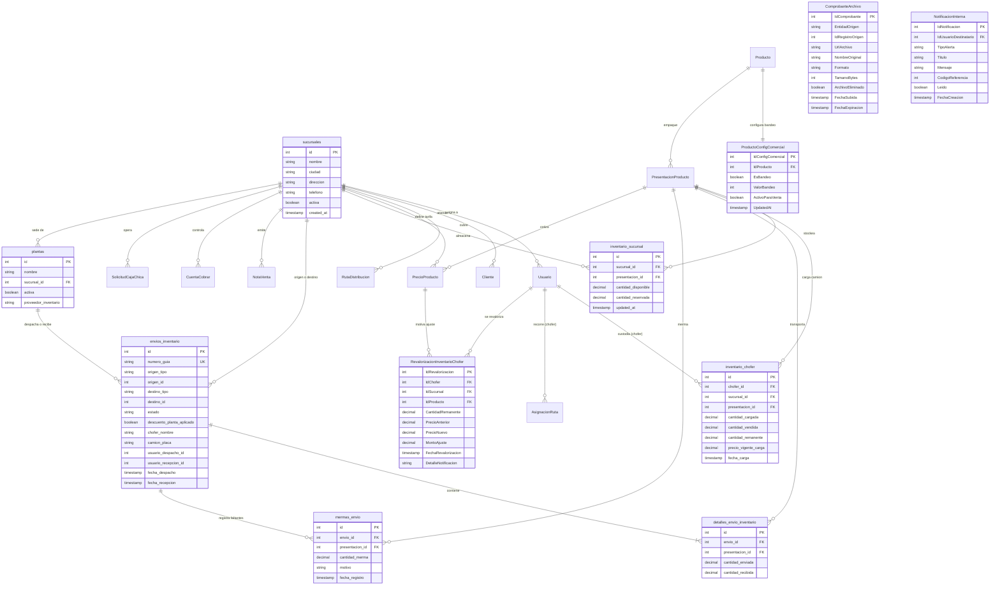

# ESQUEMA DE BASE DE DATOS - SISTEMA BLANQUITA

Este documento detalla el esquema de base de datos PostgreSQL alojado en Supabase. Se divide en: (1) Esquema real actual por introspección de scripts y modelos; (2) Tabla de mapeo entre terminología y nombres reales; (3) Nuevas tablas y columnas diseñadas para la Fase 1 con diagrama Mermaid; y (4) Secciones reservadas por módulo para los subagentes.

---

## 1. ESQUEMA REAL ACTUAL (Por Introspección)

### 1.1 Tablas Base del Sistema (`bd.sql`)
- `public.Turno` (`IdTurno` SERIAL PK, `NombreTurno` VARCHAR)
- `public.Rol` (`IdRol` SERIAL PK, `NombreRol` VARCHAR)
- `public.EstadoUsuario` (`IdEstadoUsuario` SERIAL PK, `NombreEstadoUsuario` VARCHAR)
- `public.Usuario` (`IdUsuario` SERIAL PK, `IdRol` INT FK, `IdEstadoUsuario` INT FK, `Ci` VARCHAR, `PrimerNombre` VARCHAR, `SegundoNombre` VARCHAR, `ApellidoPaterno` VARCHAR, `ApellidoMaterno` VARCHAR, `Telefono` VARCHAR, `Correo` VARCHAR, `FechaNacimiento` DATE, `Genero` CHAR, `CreatedAt` TIMESTAMP, `UpdatedAt` TIMESTAMP)
- `public.Proveedor` (`IdProveedor` SERIAL PK, `IdEstadoProveedor` INT, `NombreEmpresa` VARCHAR, `Nit` VARCHAR, `Telefono` VARCHAR, `Email` VARCHAR, `Direccion` VARCHAR)
- `public.Producto` (`IdProducto` SERIAL PK, `NombreProducto` VARCHAR, `Descripcion` TEXT, `Activo` BOOLEAN)
- `public.PresentacionProducto` (`IdPresentacion` SERIAL PK, `IdProducto` INT FK, `NombrePresentacion` VARCHAR, `UnidadesPorPaquete` INT)
- *(Tablas protegidas de planta detalladas en `docs/context/ZONA_PROTEGIDA.md`)*

### 1.2 Tablas Contables y Tesorería (`bd_contabilidad_tesoreria.sql`)
- `public.CuentaBancariaEmpresa` (`id` SERIAL PK, `banco_nombre` VARCHAR, `nro_cuenta` VARCHAR, `tipo_cuenta` VARCHAR, `moneda` VARCHAR, `saldo_actual` NUMERIC(12,2), `activa` BOOLEAN)
- `public.NotaVenta` (`id` SERIAL PK, `nro_nota` VARCHAR, `fecha_venta` TIMESTAMP, `cliente_nombre` VARCHAR, `cliente_nit` VARCHAR, `ciudad_destino` VARCHAR, `chofer` VARCHAR, `placa` VARCHAR, `condicion_venta` VARCHAR, `total_bruto` NUMERIC(12,2), `descuento` NUMERIC(12,2), `importe_neto` NUMERIC(12,2), `total_cancelado` NUMERIC(12,2), `saldo_pendiente` NUMERIC(12,2))
- `public.DetalleNotaVenta` (`id` SERIAL PK, `nota_venta_id` INT FK, `producto_nombre` VARCHAR, `cantidad` INT, `precio_unitario` NUMERIC(12,2), `subtotal` NUMERIC(12,2))
- `public.SolicitudCajaChica` (`id` SERIAL PK, `solicitante_id` INT FK, `monto_solicitado` NUMERIC(12,2), `monto_aprobado` NUMERIC(12,2), `motivo` TEXT, `estado` VARCHAR, `fecha_solicitud` TIMESTAMP, `fecha_rendicion` TIMESTAMP, `comprobante_url` TEXT)
- `public.ArqueoCajaDetalle` (`id` SERIAL PK, `arqueo_caja_id` INT, `corte_denominacion` NUMERIC(10,2), `cantidad` INT, `subtotal` NUMERIC(12,2))
- `public.CuentaPagarProveedor` (`id` SERIAL PK, `proveedor_id` INT FK, `nro_factura_o_nota` VARCHAR, `concepto` TEXT, `fecha_recepcion` DATE, `fecha_vencimiento` DATE, `monto_total` NUMERIC(12,2), `saldo_pendiente_bs` NUMERIC(12,2), `urgencia` VARCHAR, `estado` VARCHAR)
- `public.PagoCuentaPagar` (`id` SERIAL PK, `cuenta_pagar_id` INT FK, `monto_pagado` NUMERIC(12,2), `fecha_pago` TIMESTAMP, `metodo_pago` VARCHAR, `comprobante_url` TEXT)

### 1.3 Tablas de Logística, RRHH y Nuevos Módulos (`bd_modulos_nuevos.sql`)
- `public.AuditLog` (`id` SERIAL PK, `fecha_hora` TIMESTAMP, `id_usuario` INT, `usuario_nombre` VARCHAR, `rol` VARCHAR, `modulo_tabla` VARCHAR, `accion` VARCHAR, `id_registro` VARCHAR, `detalle` TEXT, `datos_anteriores` JSONB, `datos_nuevos` JSONB)
- `public.Caja` (`IdCaja` SERIAL PK, `NombreCaja` VARCHAR, `Activo` BOOLEAN)
- `public.AperturaCierreCaja` (`IdApertura` SERIAL PK, `IdCaja` INT FK, `IdUsuario` INT FK, `MontoApertura` NUMERIC(12,2), `MontoCierre` NUMERIC(12,2), `FechaApertura` TIMESTAMP, `FechaCierre` TIMESTAMP, `Estado` VARCHAR)
- `public.MovimientoCaja` (`IdMovimiento` SERIAL PK, `IdApertura` INT FK, `TipoMovimiento` VARCHAR, `Categoria` VARCHAR, `Monto` NUMERIC(12,2), `Glosa` TEXT, `Beneficiario` VARCHAR, `NroReferencia` VARCHAR, `MetodoPago` VARCHAR, `FechaHora` TIMESTAMP)
- `public.Cliente` (`IdCliente` SERIAL PK, `RazonSocial` VARCHAR, `NombreComercial` VARCHAR, `NitCi` VARCHAR, `Telefono` VARCHAR, `Ciudad` VARCHAR, `Direccion` VARCHAR, `Latitud` NUMERIC(10,7), `Longitud` NUMERIC(10,7), `LimiteCredito` NUMERIC(12,2), `Activo` BOOLEAN)
- `public.PuntoVenta` (`IdPuntoVenta` SERIAL PK, `IdCliente` INT FK, `Nombre` VARCHAR, `Direccion` VARCHAR, `Latitud` NUMERIC(10,7), `Longitud` NUMERIC(10,7))
- `public.ZonaDistribucion` (`IdZona` SERIAL PK, `NombreZona` VARCHAR, `Ciudad` VARCHAR)
- `public.RutaDistribucion` (`IdRuta` SERIAL PK, `IdZona` INT FK, `NombreRuta` VARCHAR, `Activo` BOOLEAN)
- `public.AsignacionRuta` (`IdAsignacion` SERIAL PK, `IdRuta` INT FK, `IdChofer` INT FK, `Fecha` DATE, `Estado` VARCHAR, `TotalRecaudado` NUMERIC(12,2), `ParadasTotales` INT, `ParadasEntregadas` INT)
- `public.PrecioProducto` (`IdPrecio` SERIAL PK, `IdProducto` INT FK, `PrecioUnitario` NUMERIC(12,2), `Activo` BOOLEAN)
- `public.CuentaCobrar` (`IdCuentaCobrar` SERIAL PK, `IdCliente` INT FK, `NroNota` VARCHAR, `MontoTotal` NUMERIC(12,2), `TotalAbonado` NUMERIC(12,2), `SaldoPendiente` NUMERIC(12,2), `FechaEmision` DATE, `FechaVencimiento` DATE, `DiasMora` INT, `Estado` VARCHAR)
- `public.AbonoCuentaCobrar` (`IdAbono` SERIAL PK, `IdCuentaCobrar` INT FK, `MontoAbonado` NUMERIC(12,2), `FechaAbono` TIMESTAMP, `MetodoPago` VARCHAR, `ComprobanteUrl` TEXT)
- `public.RendicionRuta` (`IdRendicion` SERIAL PK, `IdAsignacion` INT FK, `MontoEfectivoRendido` NUMERIC(12,2), `MontoQrRendido` NUMERIC(12,2), `MontoCreditoRendido` NUMERIC(12,2), `FechaRendicion` TIMESTAMP)
- `public.ConfiguracionLaboral` (`IdConfig` SERIAL PK, `PorcentajeAfp` NUMERIC(5,2), `SalarioMinimoNacional` NUMERIC(10,2), `DiasLaborablesMes` INT)
- `public.PeriodoNomina` (`IdPeriodo` SERIAL PK, `Mes` INT, `Anio` INT, `Cerrado` BOOLEAN)
- `public.DatosLaboralesEmpleado` (`IdEmpleado` SERIAL PK, `IdUsuario` INT FK, `FechaIngreso` DATE, `FechaRetiro` DATE, `TipoContrato` VARCHAR, `Cargo` VARCHAR, `Area` VARCHAR, `SueldoBasico` NUMERIC(10,2), `EsAsegurado` BOOLEAN, `Activo` BOOLEAN)
- `public.AsistenciaDiaria` (`IdAsistencia` SERIAL PK, `IdEmpleado` INT FK, `Fecha` DATE, `HoraEntrada` TIME, `HoraSalida` TIME, `MinutosAtraso` INT, `HorasExtra` NUMERIC(5,2), `Estado` VARCHAR)
- `public.Planilla` (`IdPlanilla` SERIAL PK, `IdPeriodo` INT FK, `TipoPlanilla` VARCHAR, `Aprobada` BOOLEAN, `TotalBruto` NUMERIC(12,2), `TotalLiquido` NUMERIC(12,2))
- `public.DetallePlanilla` (`IdDetalle` SERIAL PK, `IdPlanilla` INT FK, `IdEmpleado` INT FK, `SueldoBasico` NUMERIC(10,2), `HorasExtraBs` NUMERIC(10,2), `ComisionesBs` NUMERIC(10,2), `TotalGanado` NUMERIC(10,2), `DescuentoLey` NUMERIC(10,2), `AnticiposBs` NUMERIC(10,2), `DescuentoNoVenta` NUMERIC(10,2), `TotalDescuentos` NUMERIC(10,2), `LiquidoPagable` NUMERIC(10,2))

---

## 2. TABLA DE MAPEO (Nombre Sugerido en Prompt → Nombre Real en BD)

| Nombre Sugerido | Nombre Real en Base de Datos | Estado | Mapeo / Decisión |
| :--- | :--- | :---: | :--- |
| `sucursal` | `public.sucursales` | `NUEVA TABLA` | Se crea formalmente vía Alembic (`id`, `nombre`, `ciudad`, `activa`). No existía en BD previa. |
| `planta` | `public.plantas` | `NUEVA TABLA` | Catálogo multi-planta (`FABRICIO_LEGACY` para Sucre, `COMERCIAL_PROPIO` para futura Potosí). |
| `envio_fabrica` | `public.envios_inventario` | `NUEVA TABLA` | Traslados polimórficos Planta/Sucursal a Planta/Sucursal, con `descuento_planta_aplicado (bool)`. |
| `detalle_envio` | `public.detalles_envio_inventario` | `NUEVA TABLA` | Ítems del envío por `presentacion_id` con `ON DELETE RESTRICT`. |
| `merma_envio` | `public.mermas_envio` | `NUEVA TABLA` | Registro de mermas en tránsito cuando `cantidad_recibida < cantidad_enviada`. |
| `inventario_sucursal` | `public.inventario_sucursal` | `NUEVA TABLA` | Stock comercial físico en almacén por `sucursal_id` y `presentacion_id`. |
| `inventario_chofer` | `public.inventario_chofer` | `NUEVA TABLA` | Stock cargado al camión indexado por `presentacion_id`. |
| `producto_bandeo` | `public.ProductoConfigComercial` | `NUEVA TABLA` | Tabla satélite vinculada a `Producto` (no altera planta). |
| `revalorizacion` | `public.RevalorizacionInventarioChofer` | `NUEVA TABLA` | Bitácora de revalorización al cambiar precios por presentación. |
| `comprobante_archivo` | `public.ComprobanteArchivo` | `NUEVA TABLA` | Metadatos y control de depuración de fotos a 60 días. |
| `notificacion` | `public.NotificacionInterna` | `NUEVA TABLA` | Alertas para gerencia y choferes. |
| `nota_venta` | `public.NotaVenta` | `COLUMNA NUEVA` | Se extiende con `IdSucursal`, `FirmaDigitalUrl`, `NroNotaVenta`. |
| `detalle_nota_venta` | `public.DetalleNotaVenta` | `COLUMNA NUEVA` | Se vincula a `IdPresentacion` para coherencia física de inventario. |
| `precio_producto` | `public.PrecioProducto` | `COLUMNA NUEVA` | Se extiende con `IdSucursal`, `IdPresentacion`, `FechaVigenciaDesde`. |
| `cuentas_cobrar` | `public.CuentaCobrar` | `COLUMNA NUEVA` | Se extiende con `IdSucursal`, `EstadoAprobacion`. |
| `caja_chica` | `public.SolicitudCajaChica` | `COLUMNA NUEVA` | Se extiende con `IdSucursal`, `AprobacionGerencia`, `MontoReintegro`. |
| `empleado` | `public.DatosLaboralesEmpleado` | `COLUMNA NUEVA` | Se extiende con `IdSucursal`, `EsAsegurado`. |
| `cliente` | `public.Cliente` | `COLUMNA NUEVA` | Se extiende con `IdSucursal`. |
| `ruta_distribucion` | `public.RutaDistribucion` | `COLUMNA NUEVA` | Se extiende con `IdSucursal`. |

> [!IMPORTANT]
> **Decisión de Unificación de Claves y Unidades:**
> Se adopta **`IdPresentacion`** (`presentacion_id`) como clave foránea única para todo el inventario físico (fábrica, envíos, almacén de sucursal, camión de chofer y nota de venta).
> La **unidad física de medida oficial** es el contenedor o empaque terminado (**Jaba, Plancha o Fardo**, según `TipoContenedor` de `PresentacionProducto`), garantizando equivalencia directa con el stock de planta.

---

## 3. ESQUEMA DISEÑADO PARA LA FASE 1

### 3.1 Diagrama Entidad-Relación (Mermaid) - Fase 1

### 3.2 Especificación de Nuevas Tablas (Fase 1)

1. **`public.Sucursal`** (`NUEVA TABLA`)
   - `IdSucursal`: SERIAL PRIMARY KEY
   - `NombreSucursal`: VARCHAR(80) NOT NULL (ej. "Sucursal Potosí Central")
   - `Ciudad`: VARCHAR(50) NOT NULL (ej. "Potosí", "Sucre")
   - `Direccion`: VARCHAR(200) NULL
   - `Telefono`: VARCHAR(30) NULL
   - `Activo`: BOOLEAN NOT NULL DEFAULT TRUE
   - `CreatedAt`: TIMESTAMP WITH TIME ZONE DEFAULT CURRENT_TIMESTAMP

2. **`public.ProductoConfigComercial`** (`NUEVA TABLA` - Satélite sin tocar `Producto`)
   - `IdConfigComercial`: SERIAL PRIMARY KEY
   - `IdProducto`: INT NOT NULL REFERENCES public.Producto(IdProducto) ON DELETE RESTRICT
   - `EsBandeo`: BOOLEAN NOT NULL DEFAULT FALSE (indica si regala servilleta)
   - `ValorBandeo`: INT NOT NULL DEFAULT 0 (cantidad de unidades de regalo por unidad vendida)
   - `ActivoParaVenta`: BOOLEAN NOT NULL DEFAULT TRUE
   - `UpdatedAt`: TIMESTAMP WITH TIME ZONE DEFAULT CURRENT_TIMESTAMP

3. **`public.InventarioSucursal`** (`NUEVA TABLA`)
   - `IdInventarioSucursal`: SERIAL PRIMARY KEY
   - `IdSucursal`: INT NOT NULL REFERENCES public.Sucursal(IdSucursal) ON DELETE RESTRICT
   - `IdProducto`: INT NOT NULL REFERENCES public.Producto(IdProducto) ON DELETE RESTRICT
   - `CantidadDisponible`: NUMERIC(12,2) NOT NULL DEFAULT 0.00
   - `CantidadReservada`: NUMERIC(12,2) NOT NULL DEFAULT 0.00
   - `FechaActualizacion`: TIMESTAMP WITH TIME ZONE DEFAULT CURRENT_TIMESTAMP
   - UNIQUE CONSTRAINT: (`IdSucursal`, `IdProducto`)

4. **`public.InventarioChofer`** (`NUEVA TABLA`)
   - `IdInventarioChofer`: SERIAL PRIMARY KEY
   - `IdChofer`: INT NOT NULL REFERENCES public.Usuario(IdUsuario) ON DELETE RESTRICT
   - `IdSucursal`: INT NOT NULL REFERENCES public.Sucursal(IdSucursal) ON DELETE RESTRICT
   - `IdProducto`: INT NOT NULL REFERENCES public.Producto(IdProducto) ON DELETE RESTRICT
   - `CantidadCargada`: NUMERIC(12,2) NOT NULL DEFAULT 0.00
   - `CantidadVendida`: NUMERIC(12,2) NOT NULL DEFAULT 0.00
   - `CantidadRemanente`: NUMERIC(12,2) NOT NULL DEFAULT 0.00
   - `PrecioVigenteCarga`: NUMERIC(12,2) NOT NULL
   - `FechaCarga`: DATE NOT NULL DEFAULT CURRENT_DATE

5. **`public.EnvioFabricaSucursal`** (`NUEVA TABLA`)
   - `IdEnvio`: SERIAL PRIMARY KEY
   - `IdSucursalDestino`: INT NOT NULL REFERENCES public.Sucursal(IdSucursal) ON DELETE RESTRICT
   - `NroGuiaRemision`: VARCHAR(50) NOT NULL UNIQUE
   - `ChoferTransporte`: VARCHAR(100) NOT NULL
   - `PlacaCamion`: VARCHAR(20) NOT NULL
   - `Estado`: VARCHAR(25) NOT NULL DEFAULT 'EN_TRANSITO' CHECK (Estado IN ('PREPARADO', 'EN_TRANSITO', 'RECEPCIONADO', 'OBSERVADO'))
   - `FechaEnvio`: TIMESTAMP WITH TIME ZONE DEFAULT CURRENT_TIMESTAMP
   - `FechaRecepcion`: TIMESTAMP WITH TIME ZONE NULL
   - `Observaciones`: TEXT NULL

6. **`public.DetalleEnvioFabrica`** (`NUEVA TABLA`)
   - `IdDetalleEnvio`: SERIAL PRIMARY KEY
   - `IdEnvio`: INT NOT NULL REFERENCES public.EnvioFabricaSucursal(IdEnvio) ON DELETE CASCADE
   - `IdProducto`: INT NOT NULL REFERENCES public.Producto(IdProducto) ON DELETE RESTRICT
   - `CantidadEnviada`: NUMERIC(12,2) NOT NULL
   - `CantidadRecibida`: NUMERIC(12,2) NULL
   - `CantidadMermaTransporte`: NUMERIC(12,2) DEFAULT 0.00

7. **`public.RevalorizacionInventarioChofer`** (`NUEVA TABLA`)
   - `IdRevalorizacion`: SERIAL PRIMARY KEY
   - `IdChofer`: INT NOT NULL REFERENCES public.Usuario(IdUsuario) ON DELETE RESTRICT
   - `IdSucursal`: INT NOT NULL REFERENCES public.Sucursal(IdSucursal) ON DELETE RESTRICT
   - `IdProducto`: INT NOT NULL REFERENCES public.Producto(IdProducto) ON DELETE RESTRICT
   - `CantidadRemanente`: NUMERIC(12,2) NOT NULL
   - `PrecioAnterior`: NUMERIC(12,2) NOT NULL
   - `PrecioNuevo`: NUMERIC(12,2) NOT NULL
   - `MontoAjuste`: NUMERIC(12,2) NOT NULL
   - `FechaRevalorizacion`: TIMESTAMP WITH TIME ZONE DEFAULT CURRENT_TIMESTAMP
   - `DetalleNotificacion`: TEXT NULL

8. **`public.ComprobanteArchivo`** (`NUEVA TABLA` - Control de Depuración a 60 días)
   - `IdComprobante`: SERIAL PRIMARY KEY
   - `EntidadOrigen`: VARCHAR(50) NOT NULL (ej. 'ABONO_CXC', 'CAJA_CHICA', 'DISTRIBUIDOR')
   - `IdRegistroOrigen`: INT NOT NULL
   - `UrlArchivo`: TEXT NOT NULL
   - `NombreOriginal`: VARCHAR(200) NOT NULL
   - `Formato`: VARCHAR(10) NOT NULL (ej. 'JPG', 'PNG', 'PDF')
   - `TamanoBytes`: INT NOT NULL
   - `ArchivoEliminado`: BOOLEAN NOT NULL DEFAULT FALSE
   - `FechaSubida`: TIMESTAMP WITH TIME ZONE DEFAULT CURRENT_TIMESTAMP
   - `FechaExpiracion`: DATE NOT NULL DEFAULT (CURRENT_DATE + INTERVAL '60 days')

9. **`public.NotificacionInterna`** (`NUEVA TABLA`)
   - `IdNotificacion`: SERIAL PRIMARY KEY
   - `IdUsuarioDestinatario`: INT NULL REFERENCES public.Usuario(IdUsuario) ON DELETE CASCADE (NULL para broadcast admin)
   - `TipoAlerta`: VARCHAR(30) NOT NULL (ej. 'CAMBIO_PRECIO', 'NOTA_EDITADA', 'CAJA_CHICA')
   - `Titulo`: VARCHAR(150) NOT NULL
   - `Mensaje`: TEXT NOT NULL
   - `CodigoReferencia`: INT NULL
   - `Leido`: BOOLEAN NOT NULL DEFAULT FALSE
   - `FechaCreacion`: TIMESTAMP WITH TIME ZONE DEFAULT CURRENT_TIMESTAMP
   - `ExpiraEnRojo`: TIMESTAMP WITH TIME ZONE NULL (24h para cambios de precio)

### 3.3 Columnas Nuevas Aditivas en Tablas Existentes (Fase 1)

1. **`public.PrecioProducto`:**
   - `IdSucursal`: INT NULL REFERENCES public.Sucursal(IdSucursal) ON DELETE RESTRICT (`COLUMNA NUEVA`)
   - `FechaVigenciaDesde`: TIMESTAMP WITH TIME ZONE NOT NULL DEFAULT CURRENT_TIMESTAMP (`COLUMNA NUEVA`)
   - `FechaVigenciaHasta`: TIMESTAMP WITH TIME ZONE NULL (`COLUMNA NUEVA`)
   - Backfill: `UPDATE public.PrecioProducto SET IdSucursal = 1 WHERE IdSucursal IS NULL;`

2. **`public.Usuario`:**
   - `IdSucursal`: INT NULL REFERENCES public.Sucursal(IdSucursal) ON DELETE RESTRICT (`COLUMNA NUEVA`)
   - Backfill: `UPDATE public.Usuario SET IdSucursal = 1 WHERE IdSucursal IS NULL;`

3. **`public.Cliente`, `public.RutaDistribucion`, `public.NotaVenta`, `public.Caja`, `public.CuentaCobrar`, `public.CuentaPagarProveedor`:**
   - Columna `IdSucursal`: INT NULL REFERENCES public.Sucursal(IdSucursal) ON DELETE RESTRICT (`COLUMNA NUEVA`)
   - Backfill: Todos los registros preexistentes se vinculan formalmente a Sucre (`IdSucursal = 1`).

---

## 4. SECCIONES RESERVADAS PARA SUBAGENTES

### 4.1 Subagente A (Repartidores, Cierres Diarios y Notas de Venta)
*(Espacio reservado para las adiciones de la Fase 2: extensiones a `RendicionRuta`, campos de firma digital y validación de bandeo en `NotaVenta`)*

### 4.2 Subagente B (Cuentas por Cobrar y Cobros QR)
*(Espacio reservado para las adiciones de la Fase 2: `EstadoAprobacion` en `AbonoCuentaCobrar`, campos de mora)*

### 4.3 Subagente C (Distribuidores Externos)
*(Espacio reservado para las adiciones de la Fase 2: `DistribuidorExterno`, `PedidoDistribuidor`, `DetallePedidoDistribuidor`)*

### 4.4 Subagente D (Personal, Planillas y Finiquitos)
*(Espacio reservado para las adiciones de la Fase 3: campos `EsAsegurado`, `DescuentoNoVenta`, tabla `Finiquito`)*

### 4.5 Subagente E (Caja Chica y Vueltos)
*(Espacio reservado para las adiciones de la Fase 3: `AprobacionGerencia`, `MontoReintegro`, `MontoGastoReal` en `SolicitudCajaChica`)*

### 4.6 Subagente F (Panel Gerencial, Buscador y Bancos)
*(Espacio reservado para las adiciones de la Fase 4: vistas analíticas gerenciales y extensiones a `CuentaBancariaEmpresa`)*
